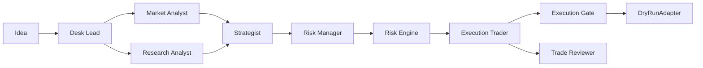

# HYPERGROK AI EMPIRE

Phase 1 of a multi-agent crypto trading desk aimed at Hyperliquid, with Solana left for a later phase. This repository currently contains a Python desk backend: a hard risk engine, a dry-run execution gate, seven rule-based agents, a read-only Hyperliquid market-data client, and SQLite persistence.

The process does **not** sign transactions, hold private keys, or send orders. Live trading is off unless `LIVE_TRADING_ENABLED=true`, and even then a live order is refused because no transmitting adapter exists.

## Current status

Implemented in this phase:

- FastAPI app with `GET /health`, `WS /ws/events`, and REST for agent status, risk config, the paper account, kill switch, risk evaluation, the journal, human approval tokens, and a desk run.
- Risk engine that returns structured `PASS` / `REJECT` decisions. Agents cannot bypass it by choosing a larger size.
- Execution gate and a `DryRunAdapter` that records the payload that would have been sent.
- Seven rule-based agents and an orchestrator. No language-model calls and no paid APIs.
- Public Hyperliquid `info` client for `allMids`, `l2Book`, and `meta`, labelled with source and fetch time.
- Pytest coverage for the limits, the gate, the orchestrator, and the HTTP/WebSocket surface. Tests use injected snapshots and a fake HTTP transport.

Not implemented yet:

- Real Hyperliquid order adapter
- Solana / Pump.fun adapters
- Wallet signing isolation
- Dashboard

Also not in this phase: exchange position sync, a live fee schedule, an LLM analyst, authentication on the API, and any path that contacts an RPC. The paper account in SQLite is local desk state, not an exchange balance. The market-data client is capable of calling the public info endpoint, but the automated tests never do; they mock the transport. Do not treat a dry-run journal row as a fill.

## Architecture



The risk engine is a separate module. The Risk Manager agent only calls it. A proposal can ask for 100% of equity minus round-trip costs; the engine still rejects the order when that breaches the reserve, the planned-risk cap, or any other rule.

Market snapshots carry `source` and `fetched_at`. The orchestrator does not fetch prices itself. If a snapshot is missing, the Market Analyst stops and does not invent a mid. Age for the risk check is the earlier of the local fetch time and the exchange timestamp when both exist.

## Agents

All seven are `rule_based`.

| Agent | Role |
| --- | --- |
| Desk Lead | Accepts a Hyperliquid idea and opens a case. Other venues are rejected. |
| Market Analyst | Reads bid, ask, and sizes. Wide spreads and stale books are not tradable. A mid with no book is not a signal. |
| Research Analyst | Uses only structured fields the caller supplied (`trend`, `funding_bps`). Free-text notes are stored and not scored. |
| Strategist | Builds an order. `risk_limited` uses the tightest of balance, reserve, and planned-risk bounds. `all_in` uses 100% of equity minus costs and can be rejected. |
| Risk Manager | Passes the order to the risk engine and returns that decision. |
| Execution Trader | Dry-runs a `PASS`. Live mode must clear the gate and is still not transmitted. |
| Trade Reviewer | Writes the journal entry. |

## Risk limits

Defaults, overridable by environment except leverage, which is fixed at 1:

| Rule | Default |
| --- | --- |
| Starting capital | 20 CHF |
| Leverage | must equal 1 |
| Planned loss per trade | 1% of equity, including round-trip fees and slippage |
| Daily realized loss | 3% of start-of-day equity blocks new entries once hit |
| Open positions | 1 |
| New entries per day | 2 |
| Hyperliquid reserve | at least 20% of equity left as free collateral after notional, fees, and slippage |
| Minimum notional | 10 USD, the Hyperliquid minimum order value given for this desk |
| Stale data | older than 5 seconds, or a timestamp more than 2 seconds in the future |
| Duplicate protection | a client order id is consumed on first sight |
| Kill switch | persisted in SQLite; blocks every new order, including reduces, while engaged |

Planned loss is `notional * stop distance / entry + notional * fee bps / 10000 + notional * slippage bps / 10000`. Fee and slippage inputs below the configured assumptions are raised to those assumptions, so a caller cannot zero them out. Default assumptions are 10 bps round-trip fees and 10 bps round-trip slippage. Those are desk assumptions, not a live fee table.

Hyperliquid cash is fully funded. Leverage does not reduce the collateral the engine holds back. Free collateral after the order must remain at least 20% of equity.

If the paper account is CHF and the minimum is 10 USD, the order must include `usd_per_notional_currency`. The engine does not invent an FX rate. The notional itself must already be in the account currency.

## Execution gate

`LIVE_TRADING_ENABLED` defaults to `false` (`LIVE_TRADING_ENABLED` or `HYPERGROK_LIVE_TRADING_ENABLED`).

- Dry-run orders are recorded by `DryRunAdapter` and marked `transmitted: false`.
- A live order while the flag is off is rejected with `live_trading_disabled`.
- A live order while the flag is on, without a matching unused approval token for that client order id, is rejected with `missing_human_approval`.
- A live order with a valid token is rejected with `live_transmission_not_implemented`. The token is not consumed. Nothing is signed or sent.

Create a token with `POST /api/approvals` and pass it on that one idea as `approval_token`. Tokens are redacted in logs and in the journal payload.

## Setup

Python 3.11 or newer.

```bash
python -m venv .venv
source .venv/bin/activate
pip install -r requirements.txt
cp .env.example .env   # optional; the file must not contain secrets
PYTHONPATH=backend uvicorn hypergrok.main:create_app --factory --host 127.0.0.1 --port 8000
```

The default database is `sqlite:///./data/hypergrok.db`, created on startup. The API has no authentication. Keep it on localhost.

Useful routes:

- `GET /health`
- `WS /ws/events`
- `GET /api/agents/status`
- `GET /api/risk/config`
- `GET /api/risk/account` and `PUT /api/risk/account` (paper state)
- `GET` and `POST /api/risk/kill-switch`
- `POST /api/risk/evaluate`
- `POST /api/desk/run`
- `GET /api/journal`
- `POST /api/approvals`
- `GET /api/execution/attempts`

`POST /api/desk/run` expects the market snapshot in the body. It does not call Hyperliquid. The info client is available as `hypergrok.marketdata.HyperliquidInfoClient` for a later wiring step.

## Tests

```bash
pytest
```

GitHub Actions (`.github/workflows/ci.yml`) runs the same command on Python 3.11.

## Safety

Do not commit private keys, seed phrases, or exchange API keys. `.env` is gitignored. `.env.example` has none. Phase 1 dependencies are FastAPI, Uvicorn, Pydantic, SQLAlchemy, HTTPX, and pytest. There is no signing library.
